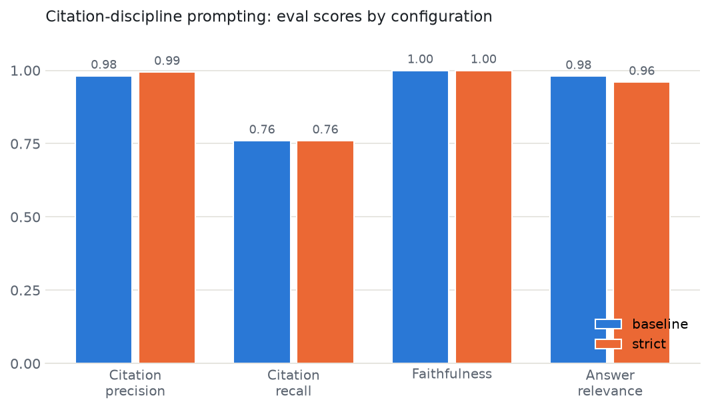

# CrossSource

**An evaluation harness for RAG answer quality and citation accuracy on public case law.**

Legal AI is a major LLM category whose most famous trust failure is citation hallucination — lawyers have been sanctioned for filing AI-fabricated citations (*Mata v. Avianca*), and academic work (Stanford RegLab, "Hallucination-Free? Assessing the Reliability of Leading AI Legal Research Tools," Magesh et al., 2024) found even dedicated legal RAG tools hallucinate at meaningful rates. CrossSource is an open, reproducible harness for measuring citation-level reliability of a RAG system on public court opinions.

This project is an independent implementation of published RAG-evaluation methods, applied to a domain where citation errors carry professional consequences.

## Headline results (v0.1)

**Human–judge agreement: 100% (15/15)** on a blind, stratified sample of the LLM judge's citation-precision verdicts — the number that determines whether any of the other numbers can be trusted ([details](results/judge_agreement.md)).



| Dimension | baseline | strict |
|---|---|---|
| Citation precision | 0.981 | **0.994** |
| Citation recall | 0.760 | 0.760 |
| Faithfulness | 1.000 | 1.000 |
| Answer relevance | 0.980 | 0.960 |

| Citation-failure taxonomy | baseline | strict |
|---|---|---|
| `right_doc_wrong_passage` | 3 | 1 |
| `missing_authority` | 6 | 6 |
| `wrong_document` | 0 | 0 |
| `unsupported_claim` | 0 | 0 |

**What the numbers say.** Both configurations share one model (`claude-opus-4-8`) and differ only in system-prompt citation-discipline rules, so deltas isolate the effect of prompted citation discipline. Three findings:

1. **Citation-discipline prompting works at the margin**: it cut right-document-wrong-passage citations 3→1 (precision 0.981→0.994). Example from the run: asked about *Erie*'s rule for diversity cases, the baseline attached a claim about Pennsylvania common law to chunk `erie_v_tompkins:0` when the supporting text is in `erie_v_tompkins:1` — a citation a reader following it would find wanting.
2. **Neither configuration fabricated**: faithfulness is 1.000 and `unsupported_claim`/`wrong_document` are zero. On a 22-document corpus with clean retrieval, failure lives in *where citations point*, not invented law.
3. **Recall is capped by retrieval, not generation**: both configurations scored 0.760 because on 6 of 25 questions BM25 never surfaced the ground-truth chunk (`missing_authority`), so neither could cite it. Improving the reader can't fix what the retriever never showed it.

## Method

- **Corpus**: 22 famous, public-domain US court opinions (16 Supreme Court, 2 federal circuit, 4 state high court) spanning constitutional law, contracts, torts, employment, civil procedure, and consumer protection. Text from the [Caselaw Access Project](https://case.law) (Harvard Law School Library); every file's provenance is in [`data/sources.json`](data/sources.json). Deliberately small and deliberately BM25-retrieved — the eval harness is the artifact, and a fancier RAG would bury the point.
- **Pipeline**: ~350-word chunks carrying `doc_id:chunk_id`, BM25 top-5 ([`src/retrieval.py`](src/retrieval.py)); a model answers with mandatory inline `[doc_id:chunk_id]` citations under two configurations — *baseline* (citation format only) vs *strict* (explicit citation-discipline rules) ([`src/generate.py`](src/generate.py)).
- **Golden set**: 25 human-authored questions with ground-truth supporting chunks and reference notes ([`data/golden.jsonl`](data/golden.jsonl)). Candidate passages were machine-scouted and verbatim-verified, but every question and note is human-written — a synthetic answer key grading a synthetic student is circular.
- **Scoring** ([`src/evaluate.py`](src/evaluate.py)): citation precision (LLM judge verifies each citation against the cited chunk's text, with a failure taxonomy), citation recall (programmatic, against ground truth), faithfulness in the style of RAGAS (Es et al., 2023), and answer relevance. LLM-as-judge follows Zheng et al. (2023) — including taking its caveats seriously:
- **Judge validation** ([`src/judge_check.py`](src/judge_check.py)): a stratified sample of judge verdicts (every "unsupported" + random "supported") labeled blind by a human, reported as percent agreement. Trusting an unvalidated judge is the failure mode this project exists to avoid. The blind labeling also caught a real harness bug — see Limitations.

## Run it

```bash
git clone <this repo> && cd crosssource
python3 -m venv .venv && .venv/bin/pip install -r requirements.txt
cp .env.example .env   # add your Anthropic API key
.venv/bin/python run_eval.py          # full eval (resumable: --resume)
.venv/bin/python src/report.py        # regenerate results table + chart
```

`run_eval.py` writes per-item results incrementally to `results/raw_results.jsonl` (interruption-safe) and aggregates to `results/summary.json`. A full run makes ~450 API calls (≈$10 at Opus pricing; set `CROSSSOURCE_MODEL` / `CROSSSOURCE_JUDGE_MODEL` to use cheaper models). To rebuild the corpus from source: `python src/fetch_corpus.py && python src/corpus_stats.py`.

## Limitations

- **n=25.** Every aggregate carries wide error bars; treat deltas as directional, not significant.
- **The golden set and judge labels were authored by a non-lawyer** (against famous, extensively documented holdings, verified against the opinion text — but a law-trained annotator, as in Magesh et al., could disagree at the margin).
- **Judge and generator share a model family**, a known self-preference bias (Zheng et al.). The human agreement check is the mitigation, not a cure — 15 labels is a spot-check, not a certification.
- **Human labeling caught a harness bug**: consecutive citations (`[a:1], [a:2]`) produced punctuation-only claim spans, which the judge scored as failures. All three original `unsupported_claim` counts were this artifact; affected items were re-scored after the fix. Kept here because it's the strongest argument in the repo for validating your judge with human eyes.
- **Retrieval is the recall ceiling** (BM25, k=5, no reranking) — by design, but it means citation recall partly measures the retriever.
- **CourtListener's API now requires authentication** for opinion text, so the corpus fetcher uses CAP static files instead.

## v0.2 ideas

Retrieval ablations (k, hybrid/rerank) to lift the recall ceiling; a second judge model family to measure cross-model agreement; law-trained annotation of a golden-set sample; more items per case; per-question difficulty tiers.

## References

- Magesh, V., et al. (2024). *Hallucination-Free? Assessing the Reliability of Leading AI Legal Research Tools.* Stanford RegLab / HAI.
- Es, S., et al. (2023). *RAGAS: Automated Evaluation of Retrieval Augmented Generation.*
- Zheng, L., et al. (2023). *Judging LLM-as-a-Judge with MT-Bench and Chatbot Arena.*
- Robertson, S., & Zaragoza, H. (2009). *The Probabilistic Relevance Framework: BM25 and Beyond.*
- Caselaw Access Project, Harvard Law School Library — corpus source.

## License

MIT. All corpus documents are public-domain US court opinions; per-document provenance in `data/sources.json`.
